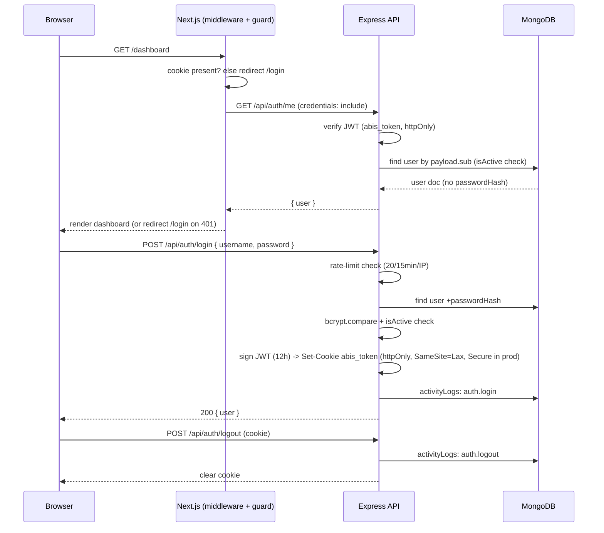

# Authentication Workflow

Security notes: JWT secret from `JWT_SECRET` (≥32 chars enforced in production); password hashed bcrypt (cost 12); account deactivation → all existing tokens rejected on next `/me`/authenticated call (isActive re-checked per request); password change invalidates nothing server-side except `mustChangePassword` flow (documented — stateless JWT invalidation limitation); login failures logged without credentials.
