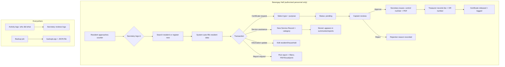

# System Workflow — Barangay Hall Operations

Key flows: resident data encoded once (central), reused by all modules, R1; every mutation logged, R2; residents have no accounts, R3 (D-14); Treasurer cannot edit residents, R4; Captain gatekeeps certificates, R5; Secretary administers accounts/settings/backup, R6.
